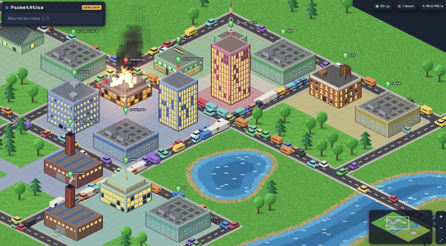

# PacketAtlas

<p align="center"></p>

A network monitor whose UI is a 16-bit isometric city. Every service you monitor is a building; the streets around it fill with cars in proportion to its traffic.

- **Targets** (buildings) are declared in YAML, or found by opt-in **discovery** of Docker Compose services and Kubernetes workloads, and grouped into **neighborhoods**.
- **Environments**: the land around the city can be `suburban`, `mountains`, `islands`, `desert` or `winter`.
- **Inside and outside**: services outside your Docker host or cluster sit apart from the city, beyond a border that depends on the environment: a river, a mountain range, open sea, a canyon or a frozen river.
- **Cars**: inbound cars (rx) drive in and pull into the building; outbound cars (tx) pull out and drive off. Most trips are local, and some come in from or leave toward the edge of the map ("the internet"). Busy services get queues.
- **Kubernetes / Docker buildings** get one floor per pod / container; lit windows are ready ones. Unless you choose a building, each gets one of five styles picked from its id, so the city looks mixed and stays the same between reloads: offices, brick apartment blocks with water towers, pitched-roof houses (they turn into apartments past three floors), art-deco towers with a setback and spire, and modern blocks with solar, garden or helipad roofs.
- **Landmarks**: mark important services, such as a firewall or a NAS, and they become big, ornate buildings that each take a whole block: a skyscraper, twin towers, a domed capitol, a neon pylon, a castle or a terraced arcology.
- **Status**: a green, amber or red map pin, plus:
  - **degraded** → a construction site: unfinished top floors as bare steel frame, scaffolding, a tower crane with a moving hook, traffic cones and an amber flasher
  - **down** → on fire: scorched walls, flames from the roof and windows, smoke and embers, and a fire engine out front with flashing lights spraying the roof
  - **unknown** (not checked yet, or the check itself failed) → greyed out with dark windows

**Contents**

- [Quickstart](#quickstart): [standalone](#1-standalone-for-testing) · [Docker Compose](#2-docker-compose) · [Kubernetes](#3-kubernetes-namespace)
- [Adding to the map](#adding-to-the-map): [checks](#add-a-check) · [neighborhoods](#put-it-in-a-neighborhood) · [colours](#colours) · [inside and outside](#inside-and-outside) · [environments](#environments) · [discovered services](#tune-discovered-buildings) · [landmarks](#landmarks-important-services) · [where checks run](#where-checks-run) · [splitting config](#split-the-config-across-files)
- [Reference](#reference): [config file](#config-file) · [checks](#checks) · [traffic](#traffic) · [discovery](#discovery) · [Docker access](#docker-access) · [Kubernetes access](#kubernetes-access) · [agents and a hub](#multiple-clusters-agents-and-a-hub) · [Helm chart](#helm-chart) ([all values](docs/helm.md)) · [command line and UI](#command-line-and-ui)
- [Troubleshooting](#troubleshooting) · [Development](#development)

## Quickstart

Pick the one that matches where PacketAtlas will run. All three end with the map at http://localhost:8080. The config is read at startup only, so restart PacketAtlas after editing it.

### 1. Standalone, for testing

**See it with fake data.** No setup needed: `-demo` invents statuses and traffic so you can look around.

```bash
git clone https://github.com/AgroDan/packetatlas && cd packetatlas
go build -o packetatlas ./cmd/packetatlas
./packetatlas -config examples/demo.yaml -demo
```

Or, without Go:

```bash
docker run --rm -p 8080:8080 -v "$PWD/examples/demo.yaml:/etc/packetatlas.yaml:ro" \
  ghcr.io/agrodan/packetatlas:latest -config /etc/packetatlas.yaml -demo
```

**Point it at something real.** Create `packetatlas.yaml` with one target per thing to watch. Each target needs a `name` and one check block:

```yaml
targets:
  - name: Company website
    http: { url: https://example.com }
  - name: Office router
    ping: { host: 192.168.1.1 }
```

```bash
./packetatlas -config packetatlas.yaml
# or
docker run --rm -p 8080:8080 -v "$PWD/packetatlas.yaml:/etc/packetatlas.yaml:ro" \
  ghcr.io/agrodan/packetatlas:latest -config /etc/packetatlas.yaml
```

Buildings are grey until their first check finishes (within 15s by default), then turn green, amber or red. Next: [add more checks](#add-a-check) and [group them into neighborhoods](#put-it-in-a-neighborhood).

### 2. Docker Compose

This adds PacketAtlas to an existing `docker-compose.yml`. Each compose project on the host becomes a neighborhood, with a building for each service showing its containers, their health and their network traffic.

PacketAtlas doesn't get the Docker socket. Access to the socket is root-equivalent. It only needs two read-only API calls, so a [socket-proxy](https://github.com/wollomatic/socket-proxy) holds the socket and allows exactly those calls, and only from the PacketAtlas container. [Docker access](#docker-access) has the details.

**1. Add these stanzas** to your `docker-compose.yml`. Merge the `networks:` entry into yours if you already have one. A complete standalone file is in [`examples/docker-compose.yaml`](examples/docker-compose.yaml).

```yaml
services:
  # ... your existing services ...

  socket-proxy:
    image: wollomatic/socket-proxy:1.13.2
    restart: unless-stopped
    user: "65534:${DOCKER_GID:?set DOCKER_GID in .env}"   # group that owns docker.sock
    mem_limit: 64M
    read_only: true
    cap_drop: [ALL]
    security_opt: [no-new-privileges]
    volumes:
      - /var/run/docker.sock:/var/run/docker.sock:ro
    command:
      - -listenip=0.0.0.0
      - -allowfrom=packetatlas            # the service name below; change both together
      - -allowGET=(/v1\.[0-9]+)?/containers/(json|[0-9a-f]+/stats)
      - -watchdoginterval=3600
      - -stoponwatchdog
    networks: [docker-api]

  packetatlas:
    image: ghcr.io/agrodan/packetatlas:latest
    restart: unless-stopped
    depends_on: [socket-proxy]
    command: ["-config", "/etc/packetatlas.yaml"]
    volumes:
      - ./packetatlas.yaml:/etc/packetatlas.yaml:ro
    ports:
      - "8080:8080"
    read_only: true
    cap_drop: [ALL]
    security_opt: [no-new-privileges]
    sysctls:
      net.ipv4.ping_group_range: "0 2147483647"   # ping targets without root
    networks: [docker-api, default]

networks:
  docker-api:
    internal: true    # only the proxy and PacketAtlas; no route out
```

**2. Tell compose which group owns the Docker socket**, in the `.env` file next to `docker-compose.yml`:

```bash
echo "DOCKER_GID=$(stat -c %g /var/run/docker.sock)" >> .env
```

**3. Create `packetatlas.yaml`** next to `docker-compose.yml`:

```yaml
docker:
  host: tcp://socket-proxy:2375     # through the proxy, not the socket

discovery:
  docker: { enabled: true }         # every compose project on this host

# Optional: things Docker doesn't run, or deeper checks of things it does.
targets:
  - name: Web health endpoint
    http: { url: http://web:8080/healthz }   # compose service names resolve here
  - name: Router
    ping: { host: 192.168.1.1 }
```

**4. Start it** with `docker compose up -d`, and open http://localhost:8080.

Notes:

- **Reaching your services:** PacketAtlas is on the project's `default` network, so HTTP and TCP checks can use compose service names (`http://web:8080`). If a service is only on a custom network, add that network to `packetatlas` too.
- **Simple ways to place services:** add [labels](#tune-discovered-buildings) to your services to rename them, pick their building, or move them into another neighborhood. For example, `packetatlas.io/neighborhood: "Storefront"`.
- **Turning off discovery:** to watch only some projects, set `discovery.docker.projects: [myapp]`. To use no discovery at all, list services as [`docker` targets](#docker) instead. They still go through the proxy.
- **Checking the proxy:** `docker compose logs socket-proxy` shows the active allowlist and any blocked requests.

### 3. Kubernetes namespace

The Helm chart runs the map inside the cluster (`mode: server`). It is published to GHCR as an OCI chart, so Helm can install it straight from `oci://ghcr.io/agrodan/charts/packetatlas` without a clone. This example installs it into the namespace it watches. Install it into its own namespace instead if you'd rather keep it separate.

**1. Write a values file** (`packetatlas-values.yaml`). It only needs the settings that differ from the chart's defaults in [`values.yaml`](chart/packetatlas/values.yaml). [docs/helm.md](docs/helm.md) documents every value, with more examples:

```yaml
mode: server

discovery:
  namespaces: [shop]                # watch only this namespace; [] = all

config:                             # any PacketAtlas config, merged over the chart's
  neighborhoods:
    - name: shop                    # no targets: just colours the "shop" namespace
      color: "#4f7cc4"
    - name: External services
      targets:
        - name: Payment provider
          http: { url: https://api.payments.example/health }
  targets:
    - name: Orders API health
      neighborhood: shop
      http: { url: http://orders.shop.svc.cluster.local/healthz, expect_status: [200] }
```

**2. Install it:**

```bash
helm upgrade --install packetatlas oci://ghcr.io/agrodan/charts/packetatlas --version 0.2.0 \
  -n shop -f packetatlas-values.yaml
kubectl -n shop port-forward svc/packetatlas 8080:80
```

The chart version is the PacketAtlas version, and the chart runs the image of that same version. To upgrade later, change `--version`. To use a clone of this repo instead, replace the chart reference with `./chart/packetatlas` and drop `--version`.

Open http://localhost:8080. Every deployment, statefulset and daemonset in `shop` becomes a building, with a floor per pod and traffic per pod. To expose the map without port-forwarding, set `server.ingress.enabled: true` and `server.ingress.host` (see [Helm chart](#helm-chart)).

Notes:

- **RBAC:** the chart creates a read-only **ClusterRole**, so installing it needs permission to create cluster-scoped RBAC. Per-pod traffic comes from the kubelet through `nodes/proxy`, which is cluster-scoped. [Kubernetes access](#kubernetes-access) lists the rules.
- **Changing the map:** edit the values file and run the same `helm upgrade` command. The pod restarts with the new config.
- **Tuning workloads:** annotate a workload to rename it, pick its building or move it to another neighborhood. For example, `kubectl -n shop annotate deploy/orders packetatlas.io/building=factory` (see [Tune discovered buildings](#tune-discovered-buildings)).
- **Several clusters on one map:** run a hub and install the chart in agent mode in each cluster (see [Multiple clusters](#multiple-clusters-agents-and-a-hub)).

## Adding to the map

### Add a check

Each target is one building with a `name` and exactly one check block. These are the common ones:

```yaml
targets:
  # A website or API: up on 2xx/3xx.
  - name: Billing API
    http:
      url: https://billing.example.com/healthz
      expect_status: [200]          # optional: only these codes count as up
      contains: '"status":"ok"'     # optional: body must contain this, else amber
    degraded_latency: 800ms         # optional: slower than this → amber

  # Anything listening on a port: databases, SSH, SMTP, …
  - name: Postgres
    tcp: { address: db.internal:5432 }

  # A host that should answer ping.
  - name: Office router
    ping: { host: 192.168.1.1 }

  # A compose service, or a single container by name.
  - name: Blog
    docker: { project: blog, service: web }

  # A Kubernetes workload.
  - name: Orders
    kubernetes: { namespace: shop, deployment: orders }
```

Every target can also take these options:

| Option | Default | Meaning |
|---|---|---|
| `neighborhood` | automatic | which neighborhood it goes in (see below) |
| `outside` | guessed from the host | `true` / `false`: whether it's outside the Docker host or cluster (see [Inside and outside](#inside-and-outside)) |
| `building` | per check type | `auto`, `office`, `apartment`, `house`, `deco`, `modern`, `tower`, `datacenter`, `factory`, `shop`, `radio`, or a [landmark](#landmarks-important-services) |
| `important` | `false` | `true` shows it as a [landmark](#landmarks-important-services) |
| `color` | | building colour: a name such as `pink`, `darkblue` or `lightpurple`, or hex such as `"#c44f4f"` (see [Colours](#colours)) |
| `interval` | `defaults.interval` (15s) | how often to check |
| `timeout` | `defaults.timeout` (3s) | how long a check may take |
| `degraded_latency` | off | turn an up check amber when it is slower than this |
| `traffic` | | take rx/tx from Prometheus instead (see [Traffic](#traffic)) |

[Checks](#checks) lists every option of every check type.

### Put it in a neighborhood

A neighborhood is a part of the city. Each target lands in exactly one, chosen by the first rule that matches:

1. **You named one.** The target is nested in a `neighborhoods:` entry, has a `neighborhood:` field, or a discovered service carries a `packetatlas.io/neighborhood` label or annotation.
2. **Its Kubernetes namespace**, for `kubernetes` targets.
3. **Its compose project**, for `docker` targets with a `project`.
4. **Outskirts**, the catch-all.

There are three simple ways to put things together. They all give the same result, and you can mix them:

```yaml
# a) Nest targets under the neighborhood.
neighborhoods:
  - name: Home Lab
    color: green                      # optional: a name or "#6aa84f"
    targets:
      - name: NAS
        tcp: { address: 192.168.1.10:445 }
      - name: Router
        ping: { host: 192.168.1.1 }

# b) Point a top-level target at it.
targets:
  - name: Printer
    neighborhood: Home Lab
    ping: { host: 192.168.1.30 }
```

```yaml
# c) Label a compose service (or annotate a Kubernetes workload) that discovery finds.
services:
  pihole:
    image: pihole/pihole
    labels:
      packetatlas.io/neighborhood: "Home Lab"
```

An entry under `neighborhoods:` with no targets only styles an automatic neighborhood of the same name, such as a namespace or compose project. It can set the colour, or `outside` (see [Inside and outside](#inside-and-outside)):

```yaml
neighborhoods:
  - name: shop          # the "shop" namespace or compose project
    color: steelblue
```

How the city is laid out:

- **Blocks:** neighborhoods with four or more buildings get whole blocks. Smaller ones share blocks, one lot per building, with plain paving marking the boundary between them.
- **Growth:** neighborhoods grow outward from the middle as organic clusters of blocks.
- **Scenery:** set by the [environment](#environments). Rivers, lakes, peaks or mesas appear once the city is big enough, and on islands the sea surrounds the city. Highways lead to each edge of the map, where through-traffic enters.
- **Stability:** the layout is seeded from neighborhood names, so it stays the same between reloads.
- **Labels:** when zoomed out, neighborhood labels say where each one came from ("k8s namespace" or "compose app").
- **Shared names:** a namespace and a compose project with the same name become one neighborhood.
- **Across the border:** neighborhoods outside the Docker host or cluster sit on the far side of a river, mountain range, sea or canyon (see [Inside and outside](#inside-and-outside)).
- **Unique names:** target names must be unique within a neighborhood.

#### Colours

Neighborhoods and buildings take a `color` in any of these forms:

- **A colour name:** any of the [CSS colour names](https://developer.mozilla.org/en-US/docs/Web/CSS/named-color), such as `pink`, `darkblue`, `gray`, `teal`, `orange`, `slategray` or `rebeccapurple`.
- **`light` or `dark` plus a name**, for shades CSS doesn't name, such as `lightpurple`, `darkpink` or `lightorange`. CSS's own names win where they exist: `lightblue` is CSS's light blue.
- **Hex:** `"#4f7cc4"` or the short `"#47c"`. Quote it, because an unquoted `#` starts a YAML comment. Hex also works without the `#`.

Names ignore case, spaces, dashes and underscores, so `Light Purple`, `light-purple` and `lightpurple` are the same colour. An unknown colour never hides anything. The neighborhood or building is drawn in its default colour instead: the next colour in the map's palette for a neighborhood, or its neighborhood's colour for a building. A warning naming the item and the colour is logged, once per bad value:

```
neighborhood "Media": unknown colour "blurple": use a name such as "pink", "darkblue" or "lightpurple", or hex such as "#4f7cc4"; using the default colour
```

In Kubernetes, see it with `kubectl -n packetatlas logs deploy/packetatlas`; in Docker Compose, with `docker compose logs packetatlas`.

### Inside and outside

When the map holds both inside and outside services, a border runs between them. What the border is depends on the [environment](#environments):

- **Inside:** services that are part of your Docker host or cluster form the city on one side.
- **Outside:** services outside it sit on the far side. Examples are SaaS APIs, a VM, your router or a managed database.
- **Crossing:** the two sides are joined by a bridge, or by a road over a mountain pass.
- **Marking:** the land on the far side is a little different (drier, wilder, or a separate island). Outside neighborhoods are labelled "outside", and so is each outside building's side panel.

If everything is inside, or everything is outside (for example, a standalone PacketAtlas that only runs HTTP checks), the map is one city as usual.

**Which targets count as outside:**

- **Inside:** `docker` and `kubernetes` targets, and discovered workloads (including those an agent discovers in its cluster).
- **`http`, `tcp` and `ping` targets** go by their host:
  - **Inside:** cluster DNS names (`*.svc`, `*.svc.cluster.local`).
  - **Inside:** bare names like `web` or `orders`, but only when the config uses Docker or Kubernetes. These are usually compose service names or same-namespace services.
  - **Outside:** everything else, including IP addresses, `localhost` and public or LAN hostnames.

**Which neighborhoods count as outside:** a neighborhood goes across the border when every building in it is outside. A neighborhood that mixes the two stays in the city.

To override the guess, set `outside` on a target or on a neighborhood. The neighborhood setting wins.

```yaml
neighborhoods:
  - name: Home Lab
    outside: true          # the whole neighborhood across the border
    targets:
      - name: NAS
        tcp: { address: nas:445 }

targets:
  - name: Legacy box
    outside: false         # treat as inside, even though it has a LAN address
    tcp: { address: 10.0.0.5:22 }
```

For an agent's cluster on a hub, the agent decides what's outside. Its outside neighborhoods (e.g. `prod/External services`) go across the border on the hub's map, alongside the hub's own outside checks.

### Environments

The environment sets the land around the city, and the border between inside and outside services:

| `environment` | Land | Border between inside and outside |
|---|---|---|
| `suburban` (default) | green lawns, parks, a river and lakes, leafy trees | a river, crossed by a bridge |
| `mountains` | alpine meadows, pines and scattered peaks | a mountain range of tall, snow-capped peaks, crossed by a road over a pass |
| `islands` | a tropical island with beaches and palms, in open sea | the sea: outside services are on an island of their own, reached by a long bridge |
| `desert` | sand, cacti, mesas and oases | a canyon, crossed by a bridge |
| `winter` | snow, snowy pines and peaks, frozen lakes | a frozen river, crossed by a bridge |

Set it in the config:

```yaml
map:
  environment: islands
```

- **Helm chart:** put it under `config:` (`config: { map: { environment: islands } }`).
- **Preview:** to try one without changing the config, add `?environment=<name>` to the map's URL, for example `http://localhost:8080/?environment=desert`. Only your browser changes.
- **Effect on the layout:** the city's blocks don't depend on the environment, except in `islands`, which has no river or lakes. Switching between the other environments keeps every building where it was.
- **Side panel:** a building's preview uses the environment's sky and the ground the building stands on, so outside buildings show the far side's ground.
- **Adding an environment:** each one is an entry in [`web/static/js/environments.js`](web/static/js/environments.js): its border (`river`, `canyon`, `ridge` or `sea`), whether the city gets a river and lakes, the scenery on open land, tree types, sky and ground colours. Add its name to `Environments` in `internal/config/config.go` too, so the config accepts it.

### Tune discovered buildings

Discovery guesses a building from the workload's name and images:

- Databases and caches (postgres, redis, mongo, …) and statefulsets are datacenters.
- Gateways and proxies (ingress, traefik, envoy, …) are towers.
- Workers and queues are factories.
- Daemonsets are shops.
- Everything else is `auto`, a mix of styles.

To change any of that, put these keys in Docker labels on a compose service, or in Kubernetes annotations on a workload:

| Label / annotation | Effect |
|---|---|
| `packetatlas.io/ignore: "true"` | never discover this one |
| `packetatlas.io/discover: "true"` | opt in, when `require_label` / `require_annotation` is set |
| `packetatlas.io/name` | building label |
| `packetatlas.io/building` | any [building](#add-a-check) |
| `packetatlas.io/neighborhood` | place it in a named neighborhood instead |
| `packetatlas.io/color` | building colour: a [name or hex](#colours) |
| `packetatlas.io/important: "true"` | show it as a [landmark](#landmarks-important-services) |

```yaml
# docker-compose.yml
services:
  db:
    image: postgres:16
    labels:
      packetatlas.io/name: "Orders database"
      packetatlas.io/neighborhood: "Storefront"
  adminer:
    image: adminer
    labels:
      packetatlas.io/ignore: "true"
```

```bash
# Kubernetes
kubectl -n shop annotate deploy/orders packetatlas.io/name="Orders API" packetatlas.io/building=tower
```

Changes apply on the next discovery scan (30s by default). Compose labels apply when the container is recreated (`docker compose up -d`).

To tune a discovered building beyond what labels can do, declare a target for the same workload: the same compose project and service, or the same namespace and deployment/statefulset/daemonset. Your declaration replaces the discovered one.

### Landmarks: important services

Mark the services that matter most, such as the firewall, the NAS or the ingress, as important, and each becomes a landmark: a big, ornate building that takes a whole city block and towers over the rest. Landmarks still show status like any building: they light up when healthy, get scaffolding and a crane when degraded, catch fire when down, and grey out when unknown.

| Landmark | Looks like |
|---|---|
| `skyscraper` | a supertall glass tower in four setbacks, with a glowing crown and a spire |
| `twins` | two glass towers joined by a sky bridge |
| `capitol` | a colonnaded marble hall with a portico, a dome and a flag |
| `pylon` | a tapering neon-laced obelisk, ringed by halos, with an orb hovering over it |
| `fortress` | a castle: curtain walls and a gatehouse, corner towers, and a keep flying a banner |
| `arcology` | a stepped megastructure of glass terraces and roof gardens, with a greenhouse dome |

The landmark is picked at random from the service's id, so it stays the same between reloads, unless you name one. Its colours (the capitol's dome, the castle's roofs and banner, the pylon's stone) follow the building or neighborhood [colour](#colours).

**A configured check:** set `important: true`, or choose a landmark as its `building`, which makes it important too:

```yaml
neighborhoods:
  - name: Infrastructure
    targets:
      - name: Firewall
        building: fortress          # a chosen landmark
        ping: { host: 10.10.90.1 }
      - name: Main NAS
        important: true             # a random landmark
        http: { url: https://nas.example.lan }
```

An important check with an ordinary building, such as `building: house`, gets a random landmark instead, and a warning is logged.

**A discovered service:** list it under a top-level `important:`, by name. Each entry is either just the name, or a mapping that also narrows it to one neighborhood or picks the landmark:

```yaml
important:
  - traefik                         # any discovered service named traefik
  - synology-csi/synology-csi-node  # "<neighborhood>/<name>"
  - name: jellyfin
    neighborhood: media             # only the one in "media"
    building: capitol               # optional: which landmark
```

- **Matching:** names are matched against the building's name on the map, ignoring case: the workload or compose service name, or its `packetatlas.io/name`. Agent-reported services on a hub match too, by their prefixed neighborhood (`prod/traefik/traefik`).
- **Only discovered services:** an entry only applies to a service that discovery actually found. A name that matches nothing, including a service you declared as a check yourself, is ignored, and the log says so once every discovery source has finished its first scan:

  ```
  important "nothere": no discovered service has that name; ignoring it until one does
  ```

  If the service turns up later, it becomes a landmark and that's logged too. With discovery turned off (and no agents pushing to this hub), the whole list is ignored with one warning at startup.
- **Labels and annotations:** instead of listing it, you can also put `packetatlas.io/important: "true"`, or a landmark in `packetatlas.io/building`, on the service itself.

**On the map:** landmarks are placed first in their neighborhood, one per block, so a neighborhood with landmarks grows by a block for each. The side panel marks them with a "landmark" tag.

### Where checks run

A check always runs from wherever PacketAtlas (or its agent) is running, so declare it in a place that can reach the service.

| Your setup | Where to declare an outside service |
|---|---|
| A single binary or container, or Docker Compose | its config file, under `targets:` |
| The Helm chart in `mode: server` | the chart's `config:` value |
| A hub plus cluster agents | the **hub's** config, so it shows as its own neighborhood. If you declare it in an agent's config, the check runs inside that cluster and shows under that cluster's prefix (e.g. `prod/External services`). Do that only for services that only the cluster can reach. |

### Split the config across files

`-config` also accepts a directory. Every `*.yaml` / `*.yml` file in it is loaded in name order:

- Later files override settings.
- Neighborhoods with the same name are merged.
- Targets are combined.

That makes it easy to keep one file per team or neighborhood:

```
conf.d/
  00-base.yaml          # server, defaults, discovery
  10-external.yaml      # the "External services" neighborhood
  20-home-lab.yaml
```

In Docker Compose, mount the directory (`./conf.d:/etc/packetatlas:ro`) and pass `-config /etc/packetatlas`.

## Reference

### Config file

All top-level keys, with their defaults. Everything is optional except that you need at least one target, an enabled discovery source, or an `agents:` list. [`examples/demo.yaml`](examples/demo.yaml) shows every option in context.

```yaml
server:
  listen: ":8080"
  push_interval: 2s         # how often browsers receive fresh state

map:
  environment: suburban     # suburban, mountains, islands, desert or winter; see Environments

defaults:                   # per-target values when a target doesn't set them
  interval: 15s
  timeout: 3s
  history_size: 120         # samples kept per target for the sparklines
  traffic_max: 50000000     # bytes/s that renders as gridlock (log scale)

docker:
  host: ""                  # unix://, tcp:// or http(s)://; empty = $DOCKER_HOST, then /var/run/docker.sock

kubernetes:
  kubeconfig: ""            # empty = in-cluster, then $KUBECONFIG / ~/.kube/config
  context: ""

prometheus:
  url: ""                   # needed only for `traffic:` queries

discovery: { ... }          # see Discovery
agents: [ ... ]             # hub side, see Multiple clusters
agent: { ... }              # agent side, see Multiple clusters
neighborhoods: [ ... ]      # see Put it in a neighborhood
targets: [ ... ]            # see Add a check
important: [ ... ]          # discovered services to show as landmarks; see Landmarks
```

### Checks

| Block | Measures | Default building |
|---|---|---|
| `http` | status code, optional body match, latency | `shop` |
| `tcp` | connect time | `datacenter` |
| `ping` | ICMP echo, loss and RTT | `radio` |
| `docker` | containers running/healthy; per-container rx/tx bytes/s | `auto` |
| `kubernetes` | pod readiness vs desired replicas; per-pod rx/tx bytes/s | `auto` |

A target's `type` is inferred from its block. Every check also turns amber if it's up but slower than the target's `degraded_latency`. A check that can't run at all, such as when the Docker API is unreachable, shows grey (unknown) with the error in the side panel.

#### `http`

```yaml
http:
  url: https://example.com/healthz   # required
  method: GET                        # default GET
  expect_status: [200, 204]          # default: any 2xx or 3xx
  contains: ok                       # optional
  insecure_skip_verify: false        # true: accept any TLS certificate
```

- **Down:** no response, or a status code outside `expect_status`.
- **Degraded:** the body (first 1 MiB) doesn't contain `contains`.
- **Redirects:** followed.

#### `tcp`

```yaml
tcp:
  address: db.internal:5432          # required, host:port
```

Up if the connection opens within `timeout`. Down otherwise.

#### `ping`

```yaml
ping:
  host: 192.168.1.1                  # required, name or IP
  count: 3                           # echoes per check, default 3
```

Up if all replies arrive, degraded if some are lost, down if none arrive.

PacketAtlas first tries an unprivileged ICMP socket, which needs Linux `net.ipv4.ping_group_range` to include its group. The compose example and the Helm chart both set this. If that fails, it falls back to a raw socket, which needs root or `CAP_NET_RAW`.

#### `docker`

```yaml
docker:
  project: blog                      # a whole compose project…
  service: web                       # …optionally narrowed to one service
  # container: my-container          # …or one container by exact name instead
```

The building gets one floor per container:

- **Ready:** a container that is running and not `unhealthy` or `health: starting`.
- **Up / degraded / down:** up when every container is ready, degraded when only some are (for example while one restarts or is rebuilt), down when none are or no containers exist.
- **One-shot jobs:** containers that exited with code 0, such as migrations, are ignored.
- **Traffic:** comes from the Engine stats API. Containers with `network_mode: host` report none.

#### `kubernetes`

```yaml
kubernetes:
  namespace: shop                    # default "default"
  deployment: orders                 # exactly one of: deployment, statefulset,
  # statefulset / daemonset / service / selector: "app=orders,tier=api"
```

The building gets one floor per pod:

- **Up / degraded / down:** up when ready pods match the desired replicas, degraded when some are ready, down when none are.
- **Traffic:** per pod, from the kubelet Summary API. Pods with `hostNetwork: true` report none.

### Traffic

Cars come from rx/tx bytes per second:

- **`docker` and `kubernetes` checks** measure traffic themselves.
- **Checks without traffic data** (`http`, `tcp`, `ping`) show a light trickle of cars while they're up.
- **`defaults.traffic_max`** sets the rate that renders as gridlock, on a log scale.

Any target can take its traffic from Prometheus instead, which replaces what the check measures:

```yaml
prometheus:
  url: http://prometheus:9090

targets:
  - name: Ingress
    http: { url: https://shop.example.com }
    traffic:
      rx: sum(rate(nginx_ingress_controller_request_size_sum[1m]))
      tx: sum(rate(nginx_ingress_controller_response_size_sum[1m]))
      unit: B/s        # label only; e.g. req/s for request rates
      max: 10000000    # gridlock value for this target; default defaults.traffic_max
```

### Discovery

Discovery is off by default. Turn it on per source:

```yaml
discovery:
  interval: 30s                 # rescan period
  docker:
    enabled: true
    projects: []                # default: all compose projects
    exclude_projects: []
    require_label: false        # true: only containers labelled packetatlas.io/discover=true
  kubernetes:
    enabled: true
    namespaces: []              # default: all
    exclude_namespaces: [...]   # default: kube-system, kube-public, kube-node-lease; [] includes them
    kinds: [deployment, statefulset, daemonset]
    require_annotation: false   # true: only workloads annotated packetatlas.io/discover: "true"
```

- **Docker:** each compose service becomes a building in its project's neighborhood. Services whose containers all exited with code 0 are treated as finished jobs and skipped. `docker compose down` removes the building, while a crashed or killed service stays and burns.
- **Kubernetes:** each deployment, statefulset and daemonset becomes a building in its namespace's neighborhood. Workloads scaled to zero are skipped.
- **Changes:** new workloads appear and deleted ones disappear on the next scan. If the API can't be reached, the current buildings stay.
- **Badge:** discovered buildings carry a "discovered" badge in the side panel.
- **Demo mode:** discovery is off in `-demo` mode.

Discovery doesn't switch itself on: nothing is mapped unless you enable a source, so PacketAtlas never shows more than you asked for. Labels, annotations and overrides are covered in [Tune discovered buildings](#tune-discovered-buildings).

### Docker access

PacketAtlas uses two Engine API calls, both read-only:

- `GET /containers/json`: lists containers, for discovery and status.
- `GET /containers/{id}/stats?stream=false&one-shot=true`: reads network counters, for traffic.

There are three ways to give it that access, from most to least locked down:

1. **Through socket-proxy (recommended).** This is the [compose quickstart](#2-docker-compose). The proxy's allowlist permits exactly those two paths, and only from the `packetatlas` host on an internal network.
   - Everything else is refused: inspect, logs, export, exec, images and `/info` get `403`, and any write such as start or stop gets `405`.
   - The `:ro` on the socket mount does not provide any of that protection, because a read-only socket can still be written to. The allowlist does.
   - If you rename the `packetatlas` service, change `-allowfrom` to match.
2. **Rootless Podman.** Set `docker.host: unix:///run/user/<uid>/podman/podman.sock` after `systemctl --user enable --now podman.socket`. Podman serves the same API with no root involved. This option is untested.
3. **The socket directly.** Mount `/var/run/docker.sock` into the container and add `group_add: ["${DOCKER_GID}"]`, or run the binary as a user in the `docker` group. This works, but it gives PacketAtlas full control of Docker.

### Kubernetes access

The client uses in-cluster config. Otherwise it uses `kubernetes.kubeconfig` / `context`, or `$KUBECONFIG` / `~/.kube/config`, so you can also run the binary on a workstation against a cluster. The chart creates these read-only rules as a ClusterRole:

```yaml
rules:
  - apiGroups: [""]
    resources: [pods, services, nodes]
    verbs: [get, list]
  - apiGroups: [""]
    resources: [nodes/proxy]          # per-pod traffic from the kubelet
    verbs: [get]
  - apiGroups: [apps]
    resources: [deployments, statefulsets, daemonsets]
    verbs: [get, list]                # list: only for discovery
```

If you manage RBAC yourself (`rbac.create: false`) and set `discovery.kubernetes.namespaces`, a Role in each namespace is enough for status. Traffic still needs `nodes/proxy`, which is cluster-scoped.

### Multiple clusters: agents and a hub

To show several clusters on one map, run one PacketAtlas as the hub and an agent in each cluster. Each agent runs discovery and checks locally and pushes the results to the hub (`POST /api/ingest`) every `push_interval`. Connections only go outbound, so no API server is exposed and no kubeconfig leaves its cluster.

On the hub, list each cluster with its own token ([`examples/hub.yaml`](examples/hub.yaml)):

```yaml
agents:
  - cluster: prod
    token_env: PROD_AGENT_TOKEN   # or token_file / token, at least 16 characters
    stale_after: 1m               # default 1m
    neighborhood_prefix: "prod/"  # the default, "<cluster>/"; "" for none
```

Then install the agent in each cluster:

```bash
helm install packetatlas oci://ghcr.io/agrodan/charts/packetatlas --version 0.2.0 \
  -n packetatlas --create-namespace \
  --set agent.hub=https://atlas.example.com \
  --set agent.cluster=prod \
  --set agent.token="$PROD_AGENT_TOKEN"        # or agent.existingSecret
```

Outside Kubernetes, run `packetatlas agent -config agent.yaml` ([`examples/agent.yaml`](examples/agent.yaml)).

- **On the map:** the agent's neighborhoods appear on the hub as `prod/<namespace>`, and their buildings carry a "cluster prod" badge. To colour one, declare `prod/<namespace>` under the hub's `neighborhoods:`.
- **Updates:** each push replaces the cluster's buildings, so deleted workloads disappear. The agent's first push waits for its first discovery scan.
- **Outages:** if an agent stops pushing for `stale_after`, its buildings go grey (unknown) and show how long it has been silent.
- **History:** the hub keeps its own history for agent buildings; agents don't send theirs.
- **Health:** the agent pod is Ready once the hub has accepted a push. `/healthz` and `/readyz` are on `agent.listen` (default `:8081`).
- **Rejected pushes:** a wrong token gets `401`. A token used with another cluster's name gets `403`. If the agent and hub are on different report versions, the push gets `400`; upgrade the older side.
- **Security:** use HTTPS for the hub, because the token goes with every push. The agent warns about plain `http://`. `agent.caBundle` (chart) or `agent.ca_file` trusts a private CA.

### Helm chart

The chart runs in one of two modes:

- **`agent` (default):** discovers the cluster and pushes to a hub.
- **`server`:** runs the whole map in the cluster, with a Service and an optional Ingress.

It's published at `oci://ghcr.io/agrodan/charts/packetatlas` for every release; `helm show values oci://ghcr.io/agrodan/charts/packetatlas --version 0.2.0` prints its defaults, which are also in [`chart/packetatlas/values.yaml`](chart/packetatlas/values.yaml). Put your own settings in a separate values file and pass it with `-f`. **[docs/helm.md](docs/helm.md)** covers every value in detail, with examples for a server, an ingress with TLS, an agent, a hub and a private registry. It also explains how `config:` merges with the chart's generated config. The main values are:

| Value | Default | Meaning |
|---|---|---|
| `mode` | `agent` | `agent` or `server` |
| `agent.hub`, `agent.cluster` | | where to push and as which cluster (agent mode, required) |
| `agent.token` / `agent.existingSecret` (+ `existingSecretKey`) | | the cluster's token; mounted as a file |
| `agent.pushInterval`, `agent.caBundle`, `agent.insecureSkipVerify` | `10s`, `""`, `false` | |
| `discovery.enabled`, `interval`, `namespaces`, `excludeNamespaces`, `kinds`, `requireAnnotation` | on, all namespaces | Kubernetes discovery |
| `config` | `{}` | any PacketAtlas config, merged over the chart's: targets, neighborhoods, defaults, prometheus, `agents:` for a server-mode hub |
| `extraEnv` | `[]` | e.g. Secret-backed variables for `token_env` |
| `server.service.type`, `server.service.port` | `ClusterIP`, `80` | |
| `server.ingress.enabled`, `className`, `annotations`, `host`, `tls` | off | |
| `image.tag`, `image.pullPolicy` | the chart's version, `IfNotPresent` | in a clone of the repo: `latest`, `Always` |
| `rbac.create`, `serviceAccount.*`, `resources`, `nodeSelector`, `tolerations`, `affinity` | | the usual |

The pod runs as non-root (UID 65532) on a read-only filesystem with every capability dropped, and sets `net.ipv4.ping_group_range` so ping works.

**Releases:** CI publishes the image `ghcr.io/agrodan/packetatlas:latest` from `main`. Pushing a `v0.2.0` git tag also publishes the image `:0.2.0` and the chart `oci://ghcr.io/agrodan/charts/packetatlas` version `0.2.0`. To publish the chart for a tag that predates the chart job, run the workflow by hand (**Actions → Build and push image and chart to GHCR → Run workflow**) with that tag.

### Command line and UI

```
packetatlas [-config FILE|DIR] [-listen ADDR] [-demo] [-web DIR]
packetatlas agent -config FILE
```

| Flag | Default | Meaning |
|---|---|---|
| `-config` | `packetatlas.yaml` | config file, or a directory of `*.yaml` files |
| `-listen` | `server.listen` | listen address |
| `-demo` | off | simulate every check with fake data |
| `-web` | embedded | serve the UI from this directory (UI development) |

**In the browser:**

- Drag to pan, scroll to zoom, and click a building for details: its pods or containers, latency, a traffic sparkline, its status history and the last error.
- Press `/` to search.
- The URL hash deep-links to the selected building.

**HTTP endpoints:** `/api/state` returns the current state as JSON, and `/api/stream` streams it as server-sent events, if you want to script against it.

## Troubleshooting

| Symptom | Cause and fix |
|---|---|
| `config defines no targets` at startup | Add a target, enable a discovery source, or list `agents:`. |
| A building stays grey | Its first check hasn't finished, or the check couldn't run. Click it: the side panel shows the error. |
| Docker buildings grey, with a `403 Forbidden` error | socket-proxy refused the request. The PacketAtlas service must be named as in `-allowfrom`, and both must be on the `docker-api` network. `docker compose logs socket-proxy` shows the refusals. |
| socket-proxy logs `permission denied` on `docker.sock` | `DOCKER_GID` doesn't match the socket's group. Re-run `stat -c %g /var/run/docker.sock`. |
| No compose services appear | Discovery isn't enabled, `projects:` filters them out, or they carry `packetatlas.io/ignore`. Only containers with compose labels are discovered. Declare others as `docker: { container: name }`. |
| Ping is always down | ICMP is blocked on the path, or the process can't open an ICMP socket. Set the `ping_group_range` sysctl as in the examples, or give it `CAP_NET_RAW`. |
| A Docker or Kubernetes building has no cars | It uses host networking, which has no per-container counters. In Kubernetes, check the `nodes/proxy` RBAC rule. Or take traffic from [Prometheus](#traffic). |
| HTTP check to a compose service fails to resolve | PacketAtlas isn't on that service's network. Add the network to the `packetatlas` service. |
| Agent pushes rejected | `401`: wrong token. `403`: token belongs to another cluster. `400`: version mismatch, so upgrade the older side. |

## Development

```bash
go build -o packetatlas ./cmd/packetatlas
go test ./...
./packetatlas -config examples/demo.yaml -demo -web web/static   # UI edits need only a browser refresh
docker build -t ghcr.io/agrodan/packetatlas:dev .
```

```
cmd/packetatlas/      entry point, flags, `agent` subcommand
internal/config/      YAML loading, merging, neighborhood grouping, validation
internal/monitor/     scheduler + history, discovery, checkers (kube, docker, ping, http, tcp, prometheus, demo)
internal/agent/       agent → hub push loop, report format, health endpoints
internal/server/      /api/state (JSON), /api/stream (SSE), /api/ingest (agent pushes), static UI
chart/packetatlas/    Helm chart (agent or server mode)
docs/helm.md          every Helm value, with examples
examples/             demo, discovery, docker-compose + docker, hub and agent configs
web/static/           embedded UI (plain ES modules, no build step)
  js/pixel.js         pixel buffer + isometric box rasteriser
  js/city.js          organic block layout, borders, roads, water, BFS paths, ground rendering
  js/environments.js  the map environments: borders, scenery, trees, palettes
  js/sprites.js       procedural buildings and landmarks, cars, trees, mountains and mesas, pins
  js/traffic.js       car spawning, lane following, queueing
  js/renderer.js      camera, depth-sorted drawing, pins/labels, effects, minimap
  js/ui.js            search, info panel, summary chips, tooltip
```
